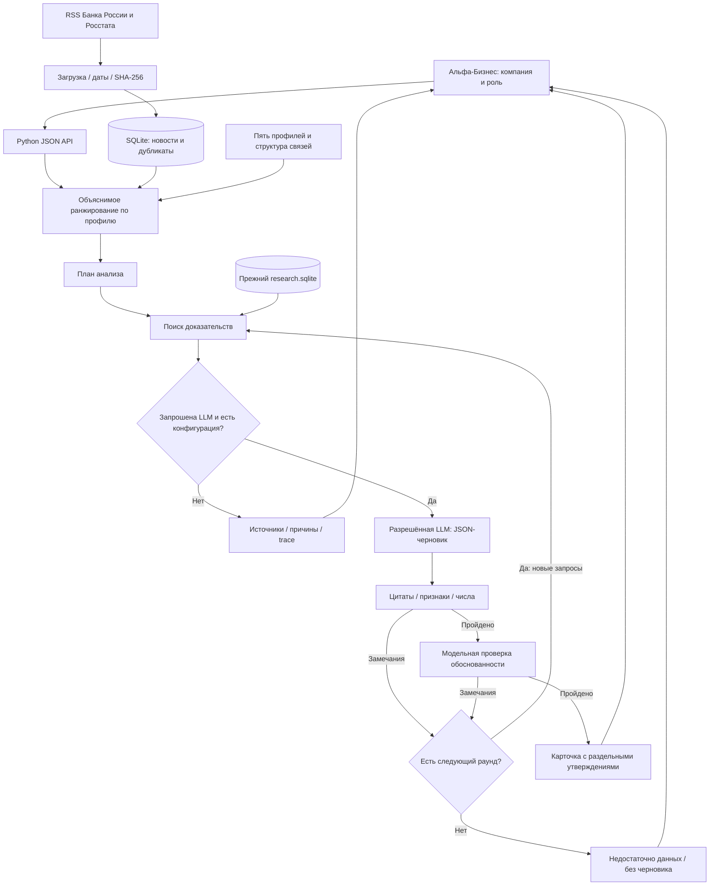

# Устройство приложения

Текущая логика `2026-10-24-v23-source-integrity`. Поставка 24.10.2026: [статус и границы](docs/RELEASE_STATUS.md).
Основная архитектура и интерфейс сохранены. Два официальных шлюза используют общий
учёт по ключу; авторизованные редиректы запрещены. Промпты задают общие ограничения
источника/периода/сегмента, частные примеры не навязываются другим отраслям.
Пояснение связано fingerprint с конкретным актуальным основным ответом, а не только
с вопросом и новостью. Полный профиль включает отдельно самопереводы и внешние связи;
генеративный контекст использует ограниченный набор подтверждённых признаков.

Python 3.12.14, SQLite FTS5, локальный ONNX encoder и HTML/CSS/JS. Прежние вызовы retrieve,
verify_quote и prepare_evidence.prepare совместимы; библиотечный retrieve по умолчанию
оставляет лексический контроль, приложение передаёт hybrid явно. Runtime-БД отделена от
исследовательского индекса; старый ZIP сохранён.

Дедупликация сохраняет снимок фактически загруженного URL в `aliases.payload`.
Изменение зеркала отделяет его от оригинала; изменение оригинала сохраняет прежние
снимки зеркал как самостоятельные новости. Метаданные одного URL не перезаписывают
другой. Все переходы выполняются одной транзакцией `BEGIN IMMEDIATE`; история анализов
и старые сырые источники сохраняются. Миграция только добавляет nullable-столбец;
неизвестные метаданные старых зеркал не выдумываются и требуют повторной загрузки.
Инициализация миграций сериализована. При первом включении WAL ожидается только
`SQLITE_BUSY`, не более 15 секунд; это локальная операция без внешних вызовов.

Refresh и все HTTP-запросы live проходят через прежнюю очередь (2 рабочих потока,
настраиваемая вместимость). Синхронный ответ сохраняется; одновременно ждать его
могут два HTTP-запроса. Остальные получают 503, освобождая потоки для ленты и статуса.

## Смысловой поиск · 22 октября

`semantic.py`: multilingual-e5-small, закреплённая ревизия и SHA-256 двух файлов;
ONNX Runtime CPU, 384 измерения, `query:`/`passage:`, маскированное среднее и L2-нормализация,
не больше 512 токенов. Модель включена в ZIP. `requirements.lock.txt` фиксирует зависимости;
`scripts/start.py` создаёт изолированное окружение и проверяет локальную готовность.

У исходного `research.sqlite` не меняются страницы, ID или текст. Соседний
`research.vectors.json` содержит векторы 74 поисковых фрагментов и хеш корпуса. Состав,
нормы векторов и версия модели проверяются; испорченный/устаревший индекс не считается готовым.
Для поиска сначала применяются дата/source_id/исторические ограничения, затем cosine
считается по всем допустимым фрагментам. BM25 не ограничивает кандидатов. В hybrid
порядок объединяет плотный ранг и FTS5/BM25. Cosine ниже 0.82 исключает только плотного
кандидата: hybrid также сохраняет сильное текстовое совпадение по всем значимым термам
или целой фразе. Частичное OR-совпадение не добавляет низкий cosine в выдачу.
У такого текстового результата semantic_rank=null; semantic_score остаётся фактическим.
Версия политики объединения отдельна от неизменённой версии векторного индекса.
Порог — инженерный параметр, не вероятность правильного ответа. Смысловая близость не
снимает проверки цитат, периодов, сегмента и неизвестных показателей клиента.

`/api/search` ранжирует новости по локальным векторам заголовка/текста после отбора по дате;
персональные причины и бизнес-приоритет сохраняются. Интерфейс отправляет запрос после
короткой паузы ввода, игнорирует запоздалые ответы, сохраняет открытую карточку при ошибке
поиска и предлагает повтор. Загрузка модели/поиск не используют генеративный шлюз.

`/api/health` и `doctor` подтверждают локальную готовность. Это не проверка остатка бюджета
или доступности LLM. Полный список пакетов и внешних компонентов сохранён отдельно.

## Остальная обработка и исторические проверки

У события: URL, публикационная дата с часовым поясом, HTML-хеш, текстовый хеш, время загрузки и выдержки с позициями. Если дата события отдельно не установлена, event_date=null. Исходники сохраняются по хешу; обновлённый текст не удаляет предыдущий файл. Запуск агента сохраняет снимок события и доказательств.

В trace явные переходы состояния и вызовы поиска. Документы из будущего/устаревшие/недатированные отсеиваются прежним поиском. Максимум шесть фрагментов в модели и два раунда по умолчанию. В тесте нехватка доказательств приводит к новому запросу и новым evidence_id, отрицательный review — к остановке без публикации.

Ключ только на backend; официальный шлюз и шесть моделей; перенаправление авторизованного запроса запрещено; error body не публикуется; кеш привязан к ключу и контексту; общий локальный счётчик резервируется транзакционно. Доходы, платежи и ФТС-флаг не отправляются как достоверные финансовые факты.

Недоверенные новости/цитаты передаются как JSON-данные, а не команды. Модель не может запускать shell или выбирать сетевой адрес; поиск ограничен длиной/числом запросов. UI использует textContent/CSP; изменяющие API-действия требуют same-origin action token. Сессия и роли демонстрационные. Публичное промышленное размещение потребует авторизации, аудита и инфраструктурных ограничений.

Лексический поиск и OCR имеют ошибки. Модельная самопроверка не доказывает истинность. Цены токенов и единицы баланса не установлены. Проверка живой LLM/Docker указана в отчёте, а не выводится из наличия кода.

Исправление живой генерации 21.10: исходный ответ исчерпал 1800 токенов завершения, которые шлюз целиком отнёс к reasoning; итоговый content был пуст. Черновик теперь ограничен 6144 токенами, review — независимыми 4096, timeout — 120 секунд. Поддержка response_format/thinking не предполагается, эти параметры не используются. Усечённый JSON не достраивается; ошибки формата останавливают запуск с метаданными. Диагностика и usage сохраняются в calls и trace без текста рассуждений.

Review использует отдельную инструкцию. Его конкретные замечания передаются следующему черновику. При дополнительном поиске сохраняются четыре исходных опорных фрагмента и добавляются до двух других. Запросы частных договоров синтетической компании исключаются из макроэкономического поиска и остаются как неизвестные данные/вопросы клиенту. Даты банковской позиции сверяются с метаданными, цитаты — с неизменённым исходным текстом. Регион регистрации не передаётся как география операций.

Историческая проверка U_1595/cfo описана в [прежнем отчёте](docs/LLM_FIX_VERIFICATION_2026-10-21.md). Её одобрение не считается актуальной проверкой смысловой опоры: обнаружен слишком уверенный перенос с автомобилей на одежду. Текущее состояние и отдельный учёт вызовов — в [отчёте исправления смысловой проверки](docs/SEMANTIC_FIX_VERIFICATION_2026-10-21.md).

Теперь агент сначала выбирает задачу: основной инсайт, пояснение, недостающие данные либо поиск. Список недостающих данных выводится из доступного профиля без LLM. Пояснение использует отдельное задание и источники актуального основного ответа; не требует искусственно придумывать кредитный риск или все разделы инсайта.

evidence.py передаёт полные страницы и проверяет сохранение исходного сегмента/периода. Точная цитата подтверждает её наличие, но не доказывает весь вывод. Локальные ограничения и новый review проверяют заголовок, краткий вывод, scope_note и условие применимости к компании. Для одежды не допускается установленная динамика по автомобилям. Смысловая истинность автоматически не доказана; конкретный контрольный результат отдельно проверяется по источникам.

Кеш результата включает fingerprint полного контекста и загруженной версии логики. Старый процесс не присваивает себе хеш нового файла до перезапуска. Основной ответ обнаруживается в runtime-БД только при точном совпадении fingerprint и дополнительно проверяется на клиенте. Исторические одобрения остаются в БД, но не отображаются как актуальные. Прежний полный JSON можно принять только как непроверенный кандидат с последующей локальной проверкой и новым versioned review; незавершённый JSON для этого непригоден.

Состояния нехватки источников, отказа проверки и технической ошибки различаются. Поиск добавляется для устранимого пробела источников; ошибка ссылки или формулировки исправляется по уже найденным страницам. В trace видны замечания каждого раунда, факт выполнения следующего раунда, использование кандидата/кеша и безопасные метаданные каждого исходного API-вызова.

## Исполнение и сохранность · 23 октября 2026

Один процесс Waitress 3.0.2 обслуживает восемь HTTP-потоков. Фоновая очередь использует
два рабочих потока и настраиваемый предел ALFA_MAX_ACTIVE_JOBS (16 queued/running). HTTP возвращает идентификатор
быстро, браузер читает реальные этапы. Уникальный активный контекст объединяет дубли.
SQLite хранит request/progress/result; локальный указатель браузера позволяет продолжить
чтение после перезагрузки. Завершённое задание перечитывает run с проверкой актуальности.

Одна runtime-папка принадлежит одному серверу (OS-lock); Windows также использует
SO_EXCLUSIVEADDRUSE для порта. При запуске прерванные задания помечаются failed без
автоматического повторного обращения к модели. При штатной остановке завершается текущий
внешний этап, а новый review не запускается. История и полный полученный кеш сохраняются.
При SIGTERM/SIGINT очередь получает request_stop до ожидания HTTP-потоков. Следующий
draft/review не запускается; завершается только уже выполняемый внешний этап.
Docker даёт 210 секунд: допустимый timeout этапа до 180 секунд и 30 секунд на завершение.
При аварийном убийстве reserved-вызов помечается interrupted_outcome_unknown, сохраняет
расходный резерв и предупреждение; автоматического повтора нет. Том не удаляется при restart.

Отзывы привязаны к run_id и UUID, повторная отправка обновляет существующую запись.
/api/metrics показывает фактические попытки, статусы вызовов/заданий, среднее время LLM и
распределение отзывов. Стоимость неизвестна и возвращается null. Метрики одной локальной
установки не заменяют общий бюджет команды на шлюзе.

Рабочие границы draft/review — 8192/6144, timeout 120 секунд. По умолчанию внутренний
предел числа запросов отключён (`ALFA_MAX_CALLS_PER_PERIOD=0`); положительное значение
остаётся необязательной настройкой владельца.
Изменение границ основано на воспроизведённом усечении DeepSeek, а не на восстановлении
неполного JSON. Все старые результаты отозваны новой версией загруженной логики.

## Историческая живая приёмка v19 · 23 октября 2026

В версии `2026-10-23-v19-independent-regeneration` черновик создавал DeepSeek,
отдельный reviewer — Gemma через тот же официальный шлюз. DeepSeek на проверяющем
этапе в нескольких запусках исчерпал 6144 токена на рассуждения без итогового JSON;
такой ответ оставался технической ошибкой. Новый этап явно выбирается через
`ALFA_LLM_REVIEW_MODEL`, без нового сервиса или SDK. Фактическая модель записана в
calls/trace/receipt; обе модели участвуют в fingerprint и общем счётчике ключа.

Полные банковские страницы сопровождаются извлечёнными ограничениями сегмента и
периода; замечания локальной проверки преобразуются в инструкции исправления.
Фраза «влияние неизвестно» распознаётся как явное ограничение, но не оправдывает
уверенный вывод в соседнем предложении. Семейная ипотека покупателя отделена от
собственного долга застройщика: оговорка о плавающей ставке компании обязательна,
когда вывод действительно относится к её кредиту. Отрицательные примеры закреплены
тестами. Ограничения платёжных связей передаются также в уточняющие вопросы.

Полный протокол и сохранённые неудачные попытки —
[FINAL_ACCEPTANCE](docs/FINAL_ACCEPTANCE_2026-10-23.md). По прямому разрешению пользователя
внутренний предел числа попыток отключён в рабочей копии и чистой поставке.
Официальный бюджет 500 ₽, период и журнал расходов сохранены.

Ручная проверка уточнения обнаружила переименование самоперевода во внутригрупповой
перевод, пропущенное reviewer. В v16 добавлены точное значение self_transfer_relation_rows
в контекст обоих этапов и локальный запрет утверждения внутригруппового назначения
без доказательства. Проверки неизвестного и вопросы клиенту остаются допустимыми.
Негативный пример сохранён; старое одобрение не считается достаточным.

В v18 обрыв черновика `length` или ответ только с reasoning вызывает один новый запрос
к явно настроенной recovery-модели. Контекст не содержит старого частичного ответа;
до двух выбранных банковских страниц сохраняются целиком, включая цитаты и ограничения.
Новый JSON проходит обычные проверки и отдельный review. Повтор относится к тому же
ключу/бюджету, сохраняет фактическую модель в ledger/trace/run и учитывается в fingerprint.
Ошибки ключа, бюджета и обычный некорректный JSON не вызывают переключения. После
повторного обрыва анализ останавливается, источники и безопасная диагностика доступны.

Публичный текст издателя в RSS — самостоятельный источник с content_scope=publisher_rss,
URL, исходным XML и хешем. Он не выдаётся за скачанную отдельную статью. HTML исполнять
нельзя; пустые RSS-описания не достраиваются. Ранее сохранённая полная статья не понижается
до короткого описания при сбое сайта.

В v19 браузер хранит независимые активные запросы и карточки по компании, роли, статье
и дате. Переход к другой статье не прерывает опрос задания и не перезаписывает чужую
карточку запоздалым ответом. Последняя реальная ошибка анализа сохраняется отдельно
от последнего проверенного основного вывода и восстанавливается через latest_run_id.
Технические подробности свёрнуты; пользователь видит причину и «Перегенерировать».

Ручная перегенерация требует request_id (32 hex), пропускает готовый результат и кеш
черновика, передаёт уникальный nonce в идентичность нового вызова и проходит обычные
проверки и новый review. Повтор того же request_id возвращает прежнее задание, в том
числе завершённое или failed. В v21 новый request_id с regenerate=true создаёт отдельную
генерацию даже при активном задании. Обычные одинаковые запросы объединяются; каждый
присоединившийся request_id сохраняется в job_requests той же транзакцией SQLite.
Повтор сетевой доставки этого ID после завершения также возвращает прежнее задание.
Синхронный /api/insights с mode=live и request_id использует ту же очередь, сохраняя
форму ответа run; старый синхронный контракт без ID оставлен для совместимости и
не даёт гарантии идемпотентности. Для оплачиваемых интеграций передавать request_id.
Два worker обрабатывают разные попытки параллельно; ёмкость очереди
ограничена настройкой. Полный браузерный ключ дополнительно включает mode, task,
полный question и родительский анализ. Присоединение по одному ID статьи исключено.
Неуспешный результат не становится основанием последующего пояснения.

В v20 один generate означает один физический POST: автоматических сетевых/HTTP
повторов нет без документированного контракта идемпотентности. Неопределённый исход
записывается и показывается перед ручной новой попыткой. Bounded draft_recovery
после известного обрыва ответа остаётся отдельным этапом; это не транспортный повтор.

news_context.py ранжирует буквальные отрезки всей статьи по заголовку, вопросу,
периодам и оговоркам, сохраняет позиции и явно отмечает неполноту. ArticleParser
исключает структурные блоки сайта, сохраняя содержательные абзацы и таблицы.
Восемь исправленных записей связаны с оригинальным HTML и старыми/новыми SHA-256
в news_cleanup_2026-10-23.json. Стартовая миграция — compare-and-swap только известного
старого хеша; более свежие записи не заменяются, runs и llm_cache не удаляются.

file_identity.py кеширует SHA-256 по пути и идентичности файла (device, inode, размер,
mtime_ns, ctime_ns), повторно проверяет метаданные после чтения и ограничивает кеш.
Обновление/замена файла инвалидирует его. Лента получает текущие статусы пакетным SQL,
без отдельных запросов к runs для каждой новости. Отпечатки сохраняют связь с новостью,
профилем, корпусом, векторным индексом и загруженной логикой. Старое одобрение не
становится актуальным только потому, что результат сохранился в истории.
