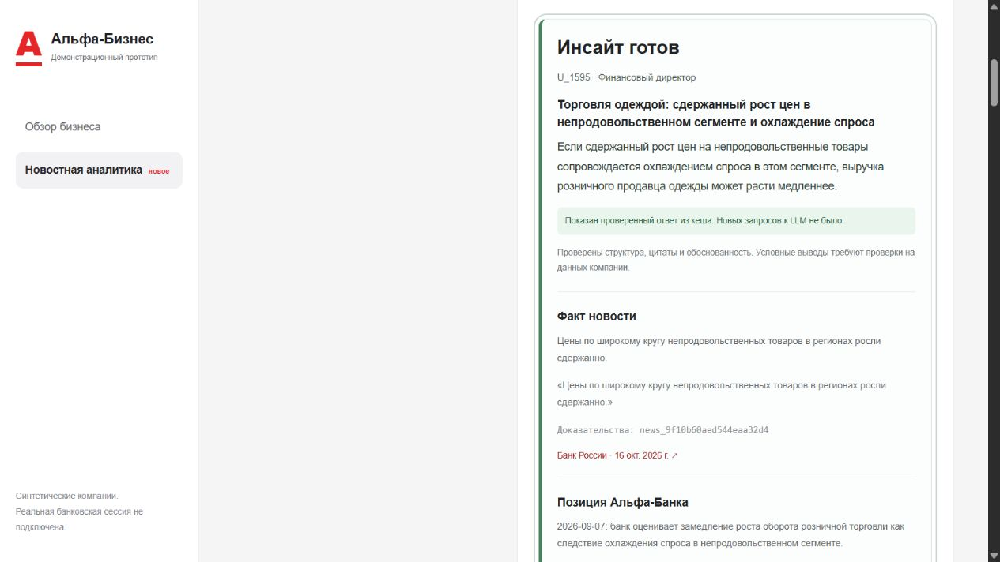
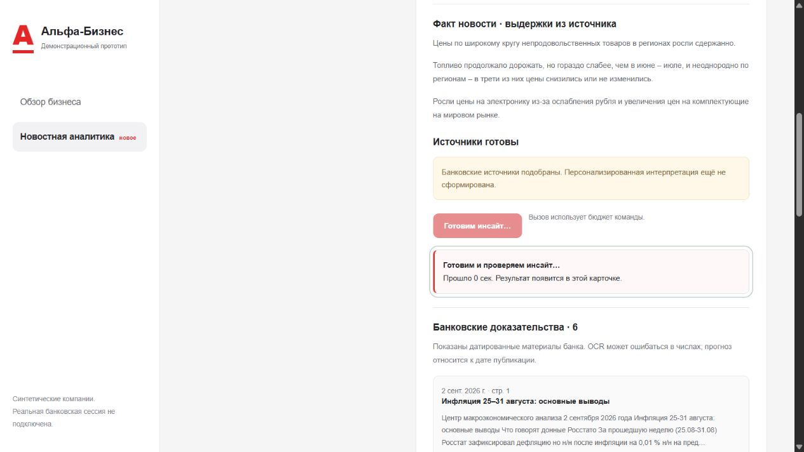
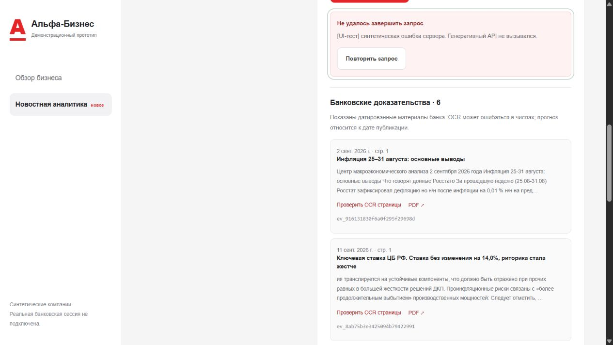

> Исторический срез до исправления смысловой опоры. Прежнее одобрение не является текущей проверкой. См. [актуальный отчёт](SEMANTIC_FIX_VERIFICATION_2026-10-21.md).

# Кнопка генерации и видимость результата · 21 октября 2026

Исправления внесены непосредственно в `web/app.js`, `web/styles.css` и `web/index.html` существующего проекта. Дополнительный runtime-установщик не создавался.

## Установленная причина

На рабочем `http://127.0.0.1:8000` воспроизведено нажатие для U_1595 / финансового директора / новости от 16.10.2026 «В большинстве регионов в сентябре цены выросли умеренно». Сервер возвращал `complete` с настоящим проверенным ответом из кеша. Замена всей карточки временной короткой заглушкой меняла высоту страницы и вызывала скачок прокрутки. После восстановления карточки пользователь видел прежний факт новости, а добавленные выводы находились ниже. Отдельного заметного подтверждения завершения не было. Это отдельная проблема интерфейса после ранее исправленной ошибки длины LLM.

При HTTP-ошибке сообщение также могло остаться выше видимой области. Старая вкладка после перезапуска сервера могла использовать прежний action token; сервер отклоняет такой запрос до запуска агента.

## Что изменено

- Во время генерации сохраняются карточка и источники, показаны статус и прошедшее время. Повторное нажатие блокируется.
- После успешной проверки открывается блок «Инсайт готов» с названием, компанией, ролью и условным выводом. Показано, получен ли ответ из кеша.
- «Показать готовый инсайт» переводит к результату без HTTP-запроса. Проверенный основной результат восстанавливается при повторном открытии новости по сохранённому ID. Проверяются статус, компания, роль, хеш новости и дата анализа.
- Ошибки сети, сервера, JSON и неполной карточки видны рядом с действием. Предыдущая карточка сохраняется, повтор выполняется явно. Единственный автоматический повтор — после обновления action token при 403; первый запрос при этом не был принят сервером.
- При смене компании/роли старая лента очищается до прихода новой. Запоздавшие ответы не заменяют другой контекст.
- Проверки доказательств, агентная логика, лимиты модели, ключ и банковский индекс в этой итерации не изменялись.

## Проверка

Рабочий сервер `:8000`: реальное нажатие основной кнопки, показ сохранённого ответа, повторная кнопка, перезагрузка и восстановление результата, две компании и две роли, фильтр/поиск, OCR банковской страницы, раскрытие 17 шагов с `finish_reason`, `requested_max_tokens`, `usage` и `reasoning_tokens`.

Ожидание и HTTP 503 дополнительно проверены в браузере на временных локальных стендах. Стенд ожидания воспроизводил сохранённый настоящий ответ через 5 секунд; стенд ошибки возвращал явно обозначенную синтетическую ошибку. Генеративные запросы эти стенды не пересылали. В приложение и архив стенды не включены; их ответы не записаны как новые результаты модели.

Офлайн: **51 Python-тест, 12 проверок корпуса, 10 тестов интерфейса**. Последние проверяют ожидание, двойное нажатие, повтор после ошибки, устаревший токен, сеть/JSON, неполный ответ, восстановление, смену контекста, отказ из-за доказательств и очистку старой ленты. Тестируется настоящий `app.js` на синтетическом DOM/HTTP без сети. Также проверены чистый архив и запуск сервера в отдельном venv без сторонних runtime-пакетов и без ключа. Машинный результат: [ui_verification_2026-10-21.json](../data/ui_verification_2026-10-21.json).

**Дополнительных платных запросов в этой UI-проверке: 0.** В таблице `calls` осталось 15 прежних записей. Ранее при исправлении генерации выполнено 12 реальных Chat Completions-запросов и один GET `/key/info`; они описаны отдельно в [отчёте LLM](LLM_FIX_VERIFICATION_2026-10-21.md). Проверка интерфейса использовала этот настоящий результат, не новую генерацию.

## Подтверждение в браузере

Рабочий сервер, настоящий проверенный ответ из кеша:



Контролируемая задержка, карточка остаётся на месте:



Контролируемая ошибка, источники и повтор доступны:



## Запуск

Из каталога проекта:

```powershell
python -X utf8 -m alfa_app serve --port 8000
```

Рабочий сервер на `:8000` оставлен запущенным. Достаточно обновить открытую страницу. В сдаваемом архиве нет `.env`, runtime-БД и временных стендов; проверяющий подключает свой ключ.
